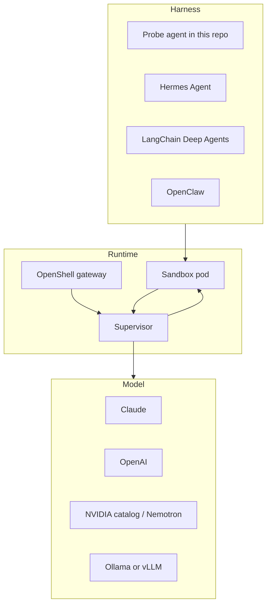

# Harness, runtime, and model

An agent that can touch a filesystem and the network is three choices stacked on top of each other. Mixing them up makes the Kubernetes install look more complicated than it is.

You pick a harness for how the agent works. You pick a runtime for where that process is allowed to act. You pick a model for the reasoning. OpenShell sits in the middle. The harness is just the command the sandbox starts. The model is just an HTTPS endpoint the policy allows, with the API key held by the gateway.

## Harness

The harness is the program that decides what to do next. It owns the prompt, the tool list, planning, memory, and when to call the model again.

| Harness | What it is | Typical process inside the sandbox |
| --- | --- | --- |
| Probe in `samples/probe-agent` | A fixed script so you can learn the boundary with no API key | `/usr/local/bin/python /opt/sample-agent/agent.py` |
| [Hermes Agent](https://github.com/NousResearch/hermes-agent) | Nous Research's agent. It stores repeated workflows as skills | The image's Hermes command. NemoClaw's blueprint starts `hermes gateway run` |
| [LangChain Deep Agents](https://docs.nvidia.com/nemoclaw/user-guide/deepagents/about/ecosystem) | A coding harness with planning, files, memory, and subagents | `dcode` for the terminal UI, `dcode -n` for a headless run |
| [OpenClaw](https://github.com/NVIDIA/nemoclaw) | A long-running local agent with tools, files, and scheduled work | The OpenClaw process the image is built around |

NemoClaw is not a fourth harness and it is not a second runtime. It is NVIDIA's reference stack: a chosen harness, OpenShell as the sandbox, and a Nemotron-oriented model path, wired by the NemoClaw CLI. If you already have a harness, a NemoClaw blueprint is one way to land it in OpenShell. This lab skips that installer and talks to the OpenShell gateway itself, which is what you will operate on a cluster either way.

The harness does not get a raw API key and it does not get an open network. It asks the runtime.

## Runtime

OpenShell is the runtime in this lab. One gateway serves the CLI. For each sandbox the Kubernetes driver creates:

- an Agent Sandbox `Sandbox` (`sandboxes.agents.x-k8s.io`), which the Agent Sandbox controller turns into the workload pod
- a supervisor pod on the trusted side of the boundary
- a Service for the authenticated channel between them
- a PVC mounted at `/sandbox`
- NetworkPolicies so the workload pod cannot open its own egress

The workload's network connections are handed to the supervisor. The supervisor checks policy, resolves DNS, and opens the upstream connection when the rule allows it. Credentials are applied there. The process inside the pod sees a placeholder, not the stored secret.

OpenShell can also run sandboxes with other drivers. The CLI surface is the same.

| Driver | Use it when |
| --- | --- |
| `kubernetes` | The sandbox should be a pod. This lab, and a datacenter cluster |
| `docker` | You want a local daemon on one machine |
| `podman` | You want rootless containers on Linux |
| `vm` | You want a microVM boundary |
| `mxc` | You want a native Windows sandbox |

Kubernetes isolation has two layers, and both have to be real:

1. The CNI enforces the pod `NetworkPolicy`. kind's default CNI, kindnet, stores the object and does not enforce it. This lab installs Cilium so a pod cannot bypass the supervisor.
2. Inside the pod, OpenShell uses Landlock for filesystem paths and a seccomp path for network calls. The supervisor is the component that allows or denies each destination.

The gateway also runs a policy prover. A proposed network rule that would grant new credentialed reach, a new HTTP method, or access to a cloud metadata address can be held for review. You can run the same check in CI with `openshell-prover`.

## Model

The model is not inside OpenShell. The sandbox calls the provider's normal API. OpenShell decides whether that binary may call that host, and it substitutes the real credential only for an endpoint the provider profile names.

Current OpenShell does this with provider profiles and per-sandbox attachments. A gateway-wide `openshell inference` route from older builds has been removed. Each sandbox that should call a model gets `--provider`. The client inside the image sends the real model id.

| Model | Where it runs | Profile in this repo |
| --- | --- | --- |
| Claude | `api.anthropic.com` | `providers/lab-anthropic.yaml` |
| OpenAI | `api.openai.com` | `providers/lab-openai.yaml` |
| Nemotron and other catalog models | `integrate.api.nvidia.com` | `providers/lab-nvidia.yaml` |
| A small open model you run yourself | Ollama Service in the cluster | `providers/lab-ollama.yaml` |
| vLLM or any other OpenAI-compatible server | Its own host | Copy `lab-openai.yaml` and change the host. Do not reuse the OpenAI profile for a different host; the key stays bound to `api.openai.com` |

The probe sandbox uses none of these. That is deliberate. You can see allow and deny before you put a secret in the gateway.

## What you operate

Day to day on the cluster you will:

1. Install the gateway once.
2. Build an image that contains the harness, or the probe.
3. Write a filesystem policy, and either a network policy or a provider profile.
4. `openshell sandbox create` with that image, that policy, and the harness command.
5. Read `openshell logs` and `openshell policy get <name> --full` when something is denied.

Steps 4 and 5 are the same on kind and on a datacenter cluster. The cluster-specific work is the CNI, the StorageClass, authentication, and where the image is stored. [docs/07-any-cluster.md](07-any-cluster.md) is that list.
